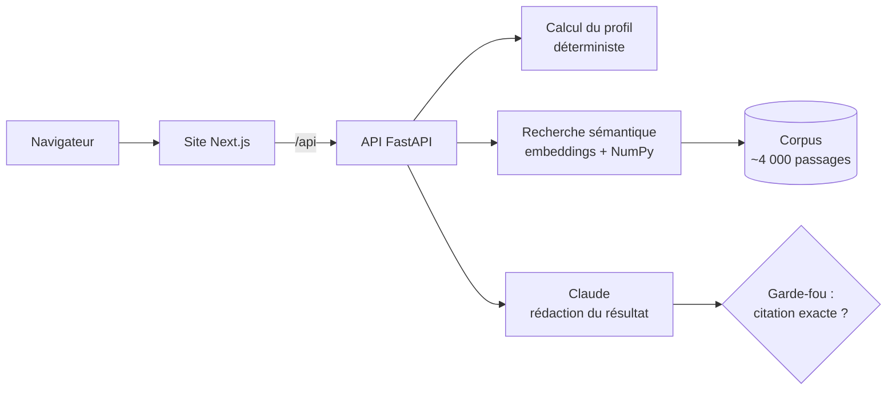

# Le métier que ta philosophie t'aurait choisi

Un questionnaire de 13 expériences de pensée (le dilemme du tramway, l'anneau de Gygès, la machine à expérience de Nozick…) qui détermine ton profil philosophique, puis te propose le métier que tu aurais pu faire, avec **une vraie citation** tirée des livres du philosophe qui te ressemble.

<p align="center">
  
  &nbsp;
  
</p>

## Ce que fait le site

1. Tu indiques ton poste actuel, ton statut et, si tu veux, le métier dont tu rêves.
2. Tu réponds à 13 dilemmes philosophiques. Chaque réponse oblige à choisir une priorité, et tu peux nuancer en écrivant avec tes mots.
3. Tu obtiens :
   - ton **profil** parmi 7 (stoïque, épicurien, sceptique, bâtisseur, créateur, moraliste, contemplatif) et ton trait dominant ;
   - le **philosophe** qui te ressemble, et une **citation exacte** tirée de ses livres, avec le lien vers le passage ;
   - le **métier** que tu aurais pu faire, deux alternatives, et l'écart avec le métier que tu vises ;
   - un **livre** à lire.

## Architecture



| Partie | Technologies | Rôle |
|---|---|---|
| Site | Next.js 16, React 19, TypeScript | Formulaire, questionnaire, page de résultat |
| API | Python, FastAPI, Pydantic v2 | Questions, calcul du profil, orchestration |
| Recherche (RAG) | sentence-transformers (`multilingual-e5-small`), NumPy | Trouver les passages qui ressemblent aux réponses |
| Rédaction | API Claude (Anthropic) | Écrire le portrait, choisir le métier et la citation |
| Corpus | Wikisource, Projet Gutenberg | Textes de philosophie du domaine public |
| Tests | pytest | 90 tests (calcul, ingestion, API) |

## Les choix techniques

**Le profil est calculé sans IA.** Il dépend uniquement des réponses, avec une formule testée : les mêmes réponses donnent toujours le même profil, et c'est gratuit. J'ai prouvé que **aucun profil n'est avantagé** : quelqu'un qui répond au hasard a exactement 20 % de score moyen pour chacun des 7 profils, qu'il coche une ou deux réponses. La démonstration et les tests sont dans [docs/SCORING.md](docs/SCORING.md).

**Les citations ne peuvent pas être inventées.** Claude reçoit 6 vrais passages du corpus et doit citer l'un d'eux. Avant d'afficher la citation, l'API vérifie qu'elle figure mot pour mot dans un des passages. Si ce n'est pas le cas, elle la remplace par un vrai extrait.

**Le site marche même sans IA.** Sans clé API, ou si Claude ne répond pas, l'API passe en « mode démo » et construit un résultat à partir de la grille et du corpus.

**Recherche sémantique sans base vectorielle.** Pour ~4 000 passages, un simple produit matrice-vecteur NumPy (similarité cosinus) répond en quelques millisecondes. Une base comme pgvector n'apporterait rien à cette taille. Les détails sont dans [docs/RAG.md](docs/RAG.md).

**Des résultats variés.** La recherche part des mots de l'utilisateur, puis tire au sort parmi les passages les plus proches. Deux personnes du même profil ne reçoivent donc pas la même citation.

## Lancer le projet

Prérequis : Python 3.11+, Node.js 20+. Une clé API Anthropic est facultative (sans clé, le site tourne en mode démo).

```bash
# 1. API
cd backend
python3 -m venv .venv
source .venv/bin/activate                      # Windows : .venv\Scripts\activate
pip install -r requirements-ingestion.txt      # ~1 Go (PyTorch)
cp .env.example .env                           # puis colle ta clé Anthropic (facultatif)

# 2. Corpus : télécharge et indexe les livres (une seule fois, quelques minutes)
python -m ingestion.telecharger
python -m ingestion.nettoyer
python -m ingestion.decouper
python -m ingestion.vectoriser

# 3. Lancer l'API
uvicorn app.main:app --reload --port 8000 --reload-include "*.json"
```

```bash
# 4. Site, dans un second terminal
cd frontend
npm install
npm run dev
```

Puis ouvre http://localhost:3000. La documentation de l'API est sur http://localhost:8000/docs.

```bash
# Tests
cd backend && python -m pytest
```

## Structure

```
backend/
├── app/
│   ├── grille/            # profils.json (7 profils) et questions.json (13 questions)
│   ├── scoring.py         # calcul du profil + vérification de la grille
│   ├── rag.py             # recherche sémantique dans le corpus
│   ├── generation.py      # appel à Claude, garde-fou des citations, mode démo
│   ├── schemas.py         # modèles Pydantic
│   └── main.py            # routes FastAPI
├── ingestion/             # télécharger → nettoyer → découper → vectoriser
└── tests/
frontend/
├── app/                   # pages Next.js
├── components/            # illustrations SVG
└── lib/api.ts             # appels à l'API
docs/                      # le calcul du profil, le RAG, les captures
```

## Les textes

Tous les textes viennent de Wikisource et du Projet Gutenberg, dans des traductions du domaine public : Épictète, Marc Aurèle, Sénèque, Épicure, Lucrèce, Montaigne, Descartes, Spinoza, Nietzsche, Kant, Rousseau, Platon, Pascal, Schopenhauer. La liste complète et les traducteurs sont dans [docs/RAG.md](docs/RAG.md).

## Suite prévue

- Questions supplémentaires adaptées au métier de l'utilisateur
- Une page « bibliothèque » pour parcourir les philosophes et leurs livres
- Mise en ligne
