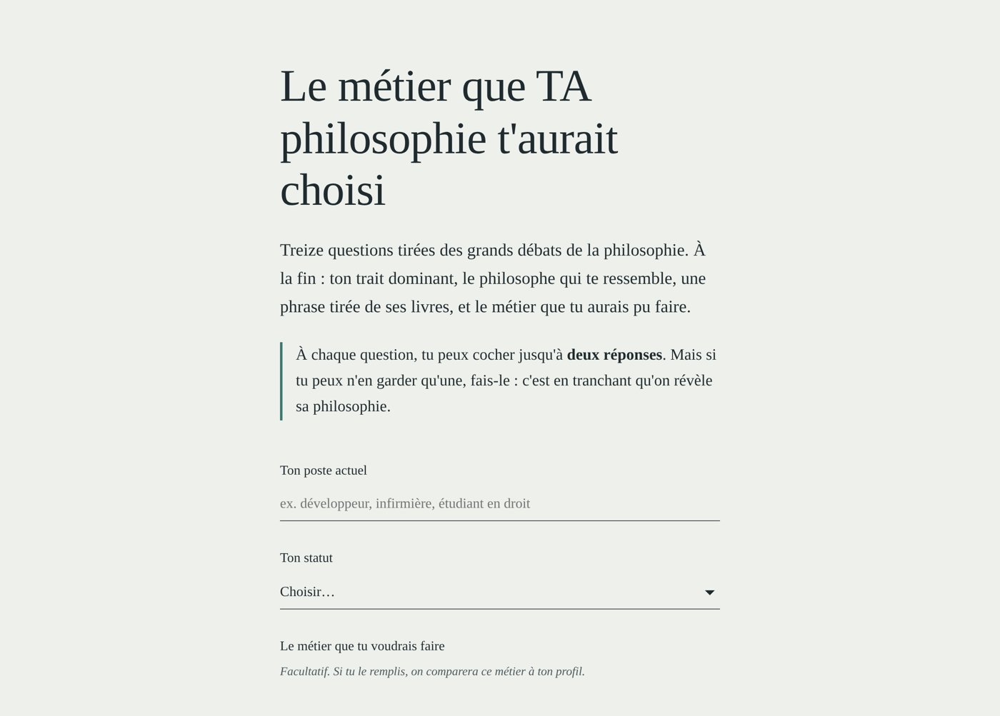
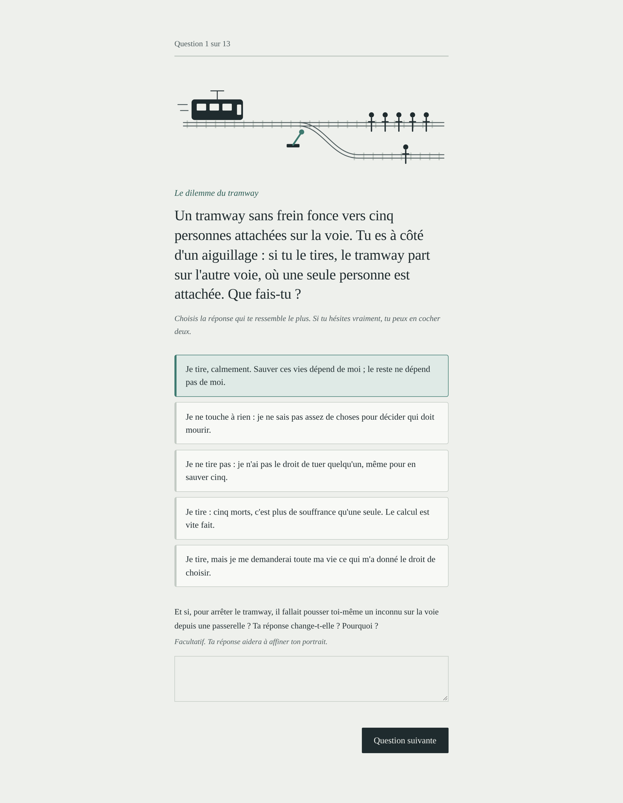
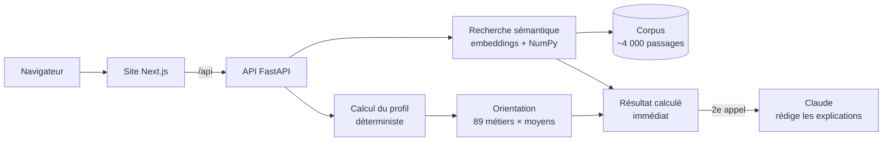

# Le métier que ta philosophie t'aurait choisi

Un questionnaire de 13 expériences de pensée (le dilemme du tramway, l'anneau de Gygès, la machine à expérience de Nozick…) qui détermine ton profil philosophique, puis te propose le métier que tu aurais pu faire, avec **une vraie citation** tirée des livres du philosophe qui te ressemble.

<p align="center">
  
  &nbsp;
  
</p>

## Ce que fait le site

1. Tu indiques ton poste actuel, ton statut et, si tu veux, le métier dont tu rêves.
2. Facultatif : tu décris ta **problématique** (« je veux quitter l'hôpital sans reprendre de longues études ») et tes **moyens** (temps, budget, délai, diplôme, mobilité, contrainte).
3. Tu réponds à 13 dilemmes philosophiques. Chaque réponse oblige à choisir une priorité, et tu peux nuancer en écrivant avec tes mots.
4. Tu obtiens **tout de suite** :
   - ton **profil** parmi 7 (stoïque, épicurien, sceptique, bâtisseur, créateur, moraliste, contemplatif) et ton trait dominant ;
   - le **philosophe** qui te ressemble, et une **citation exacte** tirée de ses livres, avec le lien vers le passage ;
   - le **métier** que tu aurais pu faire et deux alternatives, chacun avec **la voie d'accès la plus réaliste avec tes moyens** (formation, durée, coût) ;
   - un **livre** à lire.
5. Une trentaine de secondes plus tard, Claude ajoute des **explications rédigées pour toi**, l'écart avec le métier que tu vises et :
   - si tu as posé une problématique : un **diagnostic**, 2 ou 3 **pistes réalistes avec tes moyens** (durée, coût, financements, premières étapes), **une recommandation tranchée** et les risques à vérifier.

## Architecture



| Partie | Technologies | Rôle |
|---|---|---|
| Site | Next.js 16, React 19, TypeScript | Formulaire, questionnaire, page de résultat |
| API | Python, FastAPI, Pydantic v2 | Questions, calcul du profil, orchestration |
| Orientation | Tableau de 89 métiers (JSON) + règles en Python | Choisir le métier et la voie d'accès réaliste avec les moyens |
| Recherche (RAG) | `multilingual-e5-small` en ONNX int8 (onnxruntime), NumPy | Trouver les passages qui ressemblent aux réponses, rapprocher le texte libre des métiers |
| Rédaction | API Claude (Anthropic) | Expliquer les choix et répondre à la problématique, sans rien choisir |
| Corpus | Wikisource, Projet Gutenberg | Textes de philosophie du domaine public |
| Tests | pytest | 166 tests (calcul, orientation, ingestion, encodeur, API, sécurité, situation) |

## Les choix techniques

**Le profil est calculé sans IA.** Il dépend uniquement des réponses, avec une formule testée : les mêmes réponses donnent toujours le même profil, et c'est gratuit. J'ai prouvé que **aucun profil n'est avantagé** : quelqu'un qui répond au hasard a exactement 20 % de score moyen pour chacun des 7 profils, qu'il coche une ou deux réponses. La démonstration et les tests sont dans [docs/SCORING.md](docs/SCORING.md).

**Le calcul décide, l'IA rédige.** Le métier est choisi par un algorithme, dans un tableau de 89 métiers relié aux 7 profils (dont des métiers rares et des métiers à l'étranger pour qui est prêt à partir), avec pour chacun ses voies d'accès (diplôme requis, durée, coût, rythme) et un lien vers sa fiche ONISEP. Un métier n'est retenu que si une de ses voies tient dans les moyens de l'utilisateur. Le poste actuel et le métier voulu, écrits librement, départagent les métiers proches grâce au modèle d'embeddings. Claude reçoit ensuite ces choix et les explique, sans pouvoir les changer : impossible qu'il propose un métier hors de portée. Les formules et les règles sont dans [docs/SCORING.md](docs/SCORING.md#orientation--du-profil-au-métier).

**Résultat immédiat, explications ensuite.** Le résultat calculé arrive en ~50 ms. Les explications de Claude (~30 s) arrivent par un second appel et remplacent les phrases types en fondu. Comme le calcul est reproductible, ce second appel recalcule exactement le même résultat : l'API ne stocke rien.

**Les citations ne peuvent pas être inventées.** La citation affichée est toujours un extrait réel du corpus, choisi par le calcul. Claude n'en écrit aucune.

**Le site marche même sans IA.** Sans clé API, ou si Claude ne répond pas, le résultat calculé reste complet : seules les explications restent des phrases types.

**Recherche sémantique sans base vectorielle.** Pour ~4 000 passages, un simple produit matrice-vecteur NumPy (similarité cosinus) répond en quelques millisecondes. Une base comme pgvector n'apporterait rien à cette taille. Le modèle d'embeddings tourne en ONNX quantifié (int8) plutôt qu'avec PyTorch : ~120 Mo au lieu de ~1 Go, ce qui permet d'héberger l'API sur un serveur gratuit à 512 Mo. Les détails sont dans [docs/RAG.md](docs/RAG.md).

**Sécurisé pour être public.** La clé API ne quitte jamais le serveur, chaque visiteur est limité en nombre de résultats, un plafond quotidien protège le budget, et seul le site peut appeler l'API. L'audit complet et ses tests sont dans [docs/SECURITE.md](docs/SECURITE.md).

**Variés, mais reproductibles.** La recherche part des mots de l'utilisateur, puis tire au sort parmi les passages les plus proches. Le tirage est fixé par les réponses : deux personnes du même profil reçoivent des citations différentes, mais une même personne qui répond pareil retrouve exactement le même résultat.

## Lancer le projet

Prérequis : Python 3.11+, Node.js 20+. Une clé API Anthropic est facultative (sans clé, le site tourne en mode démo).

```bash
# 1. API
cd backend
python3 -m venv .venv
source .venv/bin/activate                      # Windows : .venv\Scripts\activate
pip install -r requirements-ingestion.txt
python -m app.encodeur --telecharger           # modèle d'embeddings ONNX (~120 Mo, une fois)
cp .env.example .env                           # puis colle ta clé Anthropic (facultatif)

# 2. Corpus : déjà fourni (passages + vecteurs). Pour le reconstruire depuis les livres :
python -m ingestion.telecharger
python -m ingestion.nettoyer
python -m ingestion.decouper
python -m ingestion.vectoriser

# 3. Lancer l'API
uvicorn app.main:app --reload --port 8000 --reload-include "*.json"
```

```bash
# 4. Site, dans un second terminal
cd frontend
npm install
npm run dev
```

Puis ouvre http://localhost:3000. La documentation de l'API est sur http://localhost:8000/docs.

```bash
# Tests
cd backend && python -m pytest
```

## Mise en ligne

Le site est en ligne sur Vercel (site Next.js) et Render (API en Docker, plan gratuit). Les étapes sont dans [docs/DEPLOIEMENT.md](docs/DEPLOIEMENT.md).

## Structure

```
backend/
├── app/
│   ├── grille/            # profils.json (7 profils), questions.json (13 questions), metiers.json (89 métiers)
│   ├── scoring.py         # calcul du profil + vérification de la grille
│   ├── orientation.py     # choix du métier et de la voie d'accès selon les moyens
│   ├── rag.py             # recherche sémantique dans le corpus
│   ├── encodeur.py        # modèle d'embeddings en ONNX (sans PyTorch)
│   ├── generation.py      # résultat calculé (citation, livre) et rédaction par Claude
│   ├── protection.py      # limites de requêtes, budget Claude, clé interne
│   ├── schemas.py         # modèles Pydantic
│   └── main.py            # routes FastAPI
├── ingestion/             # télécharger → nettoyer → découper → vectoriser
├── corpus/                # passages.jsonl, vecteurs.npy, index.json
├── Dockerfile             # image de l'API pour Render
└── tests/
frontend/
├── app/                   # pages Next.js + relais sécurisé vers l'API (app/api)
├── components/            # illustrations SVG
└── lib/api.ts             # appels à l'API
render.yaml                # mise en ligne de l'API sur Render
docs/                      # le calcul du profil, le RAG, la sécurité, la mise en ligne, les captures
```

## Les textes

Tous les textes viennent de Wikisource et du Projet Gutenberg, dans des traductions du domaine public : Épictète, Marc Aurèle, Sénèque, Épicure, Lucrèce, Montaigne, Descartes, Spinoza, Nietzsche, Kant, Rousseau, Platon, Pascal, Schopenhauer. La liste complète et les traducteurs sont dans [docs/RAG.md](docs/RAG.md).

## Suite prévue

- Questions supplémentaires adaptées au métier de l'utilisateur
- Une page « bibliothèque » pour parcourir les philosophes et leurs livres
