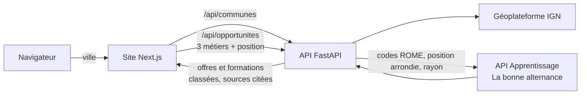

# Sources et étage 2 : offres et formations en alternance

Le site est construit comme un immeuble :

| Étage | Contenu | État |
|---|---|---|
| 1 | Profil, métier, voie d'accès réaliste avec les moyens | en ligne |
| 2 | Offres d'alternance et formations en apprentissage près de chez soi, sources citées | **en ligne** |
| 3 | Fiche formation : prix, contact, taux d'emploi des anciens, trajet, comparaison | prévu |
| 4 | Compte **facultatif** : retrouver ses résultats et ses offres sur un autre appareil, suivi des candidatures | à décider |

Principe : tout ce qui sert à s'orienter et à trouver (étages 1 à 3) marche **sans compte**. L'adaptation
automatique du CV et de la lettre par l'IA est abandonnée pour l'instant (coût d'infrastructure trop élevé).

## Les sources de l'étage 2

| Source | Ce qu'elle donne | Accès |
|---|---|---|
| [La bonne alternance](https://labonnealternance.apprentissage.beta.gouv.fr) (ministère du Travail, beta.gouv.fr), via l'[API Apprentissage](https://api.apprentissage.beta.gouv.fr) | offres en alternance publiées sur La bonne alternance et chez ses partenaires (France Travail, Indeed…), entreprises qui recrutent sans offre, formations en apprentissage du catalogue national des Carif-Oref (organisme, lieu, sessions, téléphone, email, fiche ONISEP) | clé gratuite (`LBA_API_KEY`), usage non commercial |
| [Géoplateforme de l'IGN](https://geoservices.ign.fr/services-geoplateforme-geocodage) | position des communes (champ « Où cherches-tu ? ») | libre, sans clé |
| [ONISEP](https://www.onisep.fr), jeu « Idéo-Fiches métiers » (data.gouv.fr) | lien vers la fiche de chaque métier, et ses codes ROME, qui servent à chercher offres et formations | fichier ouvert, utilisé une fois pour construire `metiers.json` |

Chaque carte du site dit d'où vient l'information (« via France Travail ») et depuis quand l'offre est publiée.

## Le chemin d'une recherche

1. L'utilisateur tape sa ville (suggestions de la Géoplateforme) ou clique « Autour de moi ».
2. Le site envoie en **un seul appel** les métiers proposés et la position.
3. Pour chaque métier, l'API interroge La bonne alternance avec ses codes ROME, en parallèle pour les offres et les formations.
4. L'API nettoie les réponses (texte simple, liens `https://` seulement), enlève les doublons publiés chez plusieurs partenaires, calcule la distance et classe.
5. La réponse est gardée 30 minutes en mémoire : changer de rayon ou revenir ne relance pas tout.

## Le classement, le même pour tout le monde

- **Offres** : les plus proches d'abord ; à distance égale (à 5 km près), les plus récentes.
- **Formations** : les plus proches d'abord ; à distance égale, celle dont la session commence le plus tôt.

Le site en garde 5 offres et 3 formations par métier, et donne le lien vers la même recherche complète sur La bonne alternance.

## Vie privée

- La ville choisie reste dans le navigateur (`localStorage`), pour la prochaine visite. L'API ne l'enregistre pas.
- La position envoyée à La bonne alternance est arrondie à 0,01° (environ 1 km).
- Le bouton « Autour de moi » demande toujours la permission au navigateur, et seul le site lui-même peut l'utiliser (`Permissions-Policy: geolocation=(self)`).

## Limites connues

- Les codes ROME viennent des fiches ONISEP. Pour 15 métiers, il n'y en a pas, ou ils ne mènent pas à l'alternance (métiers à l'étranger, accès par concours) : le site l'explique au lieu d'afficher une liste vide.
- L'API Apprentissage réserve l'**envoi de candidatures** aux plateformes partenaires : le bouton mène à la page de l'offre, où l'on postule.
- Les offres hors alternance (France Travail) et les prix des formations hors apprentissage (Mon Compte Formation) viendront aux étages suivants.

## Tests

`backend/tests/test_opportunites.py` simule les réponses des deux API (aucun appel réel) : transformation des offres, liens dangereux écartés, classement, doublons, cache, panne de l'API, absence de clé, communes.
